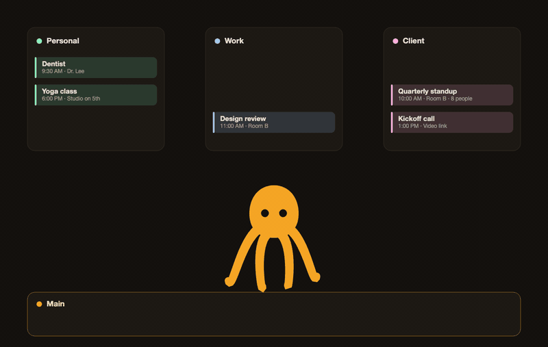

# Calopod

*Many calendars. One schedule.* More at [calopod.elijahquintana.pro](https://calopod.elijahquintana.pro).


<p align="center">
  <a href="https://calopod.elijahquintana.pro">
    
</p>


If your calendars live in different places (work, personal, a side project), each one only knows about its own events. Calopod runs on your Mac, reads the calendars you pick, and keeps them in step:

- **Busy blocks.** Events from one calendar show up as plain "Busy" on the others, so nobody double-books you.
- **A Main calendar.** One calendar that holds every event, with full details.
- **Availability.** Your combined free and busy time across everything you selected.
- **An inbox.** Invitations that need an answer, changes you haven't seen, and conflicts, with Yes, No and Maybe replies for Google and Microsoft invitations.


It never edits or deletes events it didn't create. Sign-in tokens go in your Keychain, and everything else stays on your Mac. There are two exceptions. The optional [iPhone feed](docs/iphone-feed.md) is off until you turn it on and goes only to your own private iCloud, unless you invite someone with another Apple ID to read it. It sends no events until you choose calendars, and for those the event titles are stored in your iCloud. Checking for updates asks GitHub for the newest release, only when you click Check for updates or run `calopod update check`, or once a day if you turn that on in Settings. It sends no calendar data.

## Words you'll see

| Term | Meaning |
|---|---|
| **Connection** | A calendar account Calopod reads from, such as your Mac's calendars, Google, or Microsoft. |
| **Arm** | A copy route: events from one or more source calendars go to one target calendar. |
| **Rule** | What an Arm may copy. `Busy` copies times only. `Full details` also copies title, location and notes. |
| **Main calendar** | A target that receives everything with full details. |

## Requirements

An Apple Silicon Mac running macOS 14 or newer. Calopod is a command-line tool for now.

## Get started

1. [Install Calopod](docs/install.md) and run `calopod-setup`. It walks you through choosing calendars and setting up Main and Busy.
2. Read [Using Calopod](docs/using-calopod.md) for day-to-day commands.
3. Turn on [automatic sync](docs/automatic-sync.md) once a manual sync looks right.

To build from source you need Swift 6.1 or newer:

```sh
swift build
swift test --disable-sandbox
```

## Guides

The same guides, with search, are on the [docs site](https://calopod.elijahquintana.pro/docs/).

- [Install](docs/install.md)
- [Using Calopod](docs/using-calopod.md)
- [The Mac app](docs/mac-app.md)
- [Inbox and invitations](docs/inbox.md)
- [iPhone feed](docs/iphone-feed.md)
- [Automatic sync](docs/automatic-sync.md)
- [Google and Microsoft accounts](docs/google-and-microsoft.md)
- [Troubleshooting and backups](docs/troubleshooting.md)
- [Command reference](docs/command-reference.md)
- [How it works](docs/how-it-works.md)
- [Releasing](docs/releasing.md) (maintainers)

## Contributing and security

See [CONTRIBUTING.md](CONTRIBUTING.md) and [SECURITY.md](SECURITY.md).

## License

[MIT](LICENSE)
